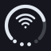

# Duo Status

`pschmitt/duo-status` is an iPhone Duo-inspired status widget and popup panel for Noctalia.
It combines the battery gauge, connectivity type, and signal strength into a single circular visual badge in the bar, and opens an integrated power & network management panel when clicked.

| Bar | Panel |
| --- | --- |
|  |  |

## Features

- **Circular Duo Indicator**:
  - **Outer Arc**: Sweeps 270° around the top and sides, displaying battery percentage with color-coded states (normal, charging green with lightning bolt, Low Power yellow, critical red).
  - **Center Glyph**: Displays the current network type (Wi-Fi, Ethernet, or Disconnected).
  - **Bottom Signal Dots**: 4 curved dots filling the lower gap of the circle, showing wireless link quality (0 to 4 dots).
- **Zero-Overhead Vector Rendering**:
  - Dynamically rendered as an SVG on state changes and served via `ui.image`, ensuring pixel-perfect sharpness at any display scale.
- **Combined Control Panel**:
  - **Power Section**: Battery percentage, charging rate in Watts, estimated time remaining, and power profile switcher (`Power Saver`, `Balanced`, `Turbo`).
  - **Network Section**: Current SSID, IP address, device, signal percentage, Wi-Fi rescan, and a list of nearby available networks.
  - One-click shortcut to Noctalia's full Control Center Network view.

## Requirements

- Linux with `/sys/class/power_supply/` and `/proc/net/wireless`.
- NetworkManager (`nmcli`) for Wi-Fi management and network enumeration.
- `powerprofilesctl` for power profile switching.
