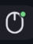

# Lan Mouse

Bar icon + panel for [lan-mouse](https://github.com/feschber/lan-mouse), a
software KVM switch for sharing a mouse/keyboard on the LAN.

lan-mouse has no IPC/CLI query for "which side currently owns the cursor
right now" — `lan-mouse cli list` only reports per-client connection state
(hostname, position, whether that client connection is active), not input
focus. This plugin instead polls a sentinel file that nixos-config's
`home-manager/gui/lan-mouse.nix` `enter_hook` maintains: it holds the peer's
name while control is away from this host, and is removed once control
returns. The bar icon is always visible. Its dot is green when
`lan-mouse.service` is running and muted when it is stopped; when input is
away, the peer name can be shown beside it.

The panel lists configured peers (from `lan-mouse cli list`) with their
connection state, and an Enable/Disable button per peer
(`lan-mouse cli activate`/`deactivate`), plus a header button that starts or
stops the local `lan-mouse.service`. Commands are overridable via
`start_command` and `stop_command`.
While the local service is running, it checks each peer's
`lan-mouse.service` state over SSH every ten seconds. This uses the configured
SSH host aliases and batch authentication; unreachable peers show as such.

A lockscreen widget adds a "Bring input back" button, shown only while the
local service is active and `incoming_sentinel` says a peer's input is
actually flowing into this host.
lan-mouse normally releases capture by watching the cursor cross back over
the screen edge on the receiving side, but a session lock there grabs input
exclusively, so that check never fires — confirmed live 2026-09-17, mouse
stuck on a locked gk4 with no way back except nixos-config's `releaseBind`
key combo. The button runs the same escape hatch from a click:
`~/.config/lan-mouse/go-back` (`home-manager/gui/lan-mouse.nix`'s
`goBackScript`) restarts *this host's own* lan-mouse.service -- killing the
connection is what the peer's own daemon already treats as "releasing
capture: not connected", the same effect `releaseBind` has, needing no ssh
for the release itself. In parallel over ssh, it also restarts the peer's
own service (belt-and-suspenders, not required for the release) and clears
its `away_sentinel` file. (An earlier version instead ran
`lan-mouse cli deactivate`+`activate` on the peer over ssh; confirmed live
2026-09-17 to leave the peer's daemon silently skipping `enter_hook` on the
next real capture into it, even though capture itself kept working.)
Note: neither `away_sentinel` nor `incoming_sentinel` update when
`releaseBind`'s physical key combo is used instead of edge-crossing or this
button — that bypasses every hook lan-mouse fires, so the button can stay
visible a little longer than strictly necessary in that case.

## Settings

- `away_sentinel` — path to the away-sentinel file. Supports
  `$XDG_RUNTIME_DIR` and `~` expansion.
- `incoming_sentinel` — path to the incoming-sentinel file (away_sentinel's
  counterpart on the receiving side). Same expansion rules.
- `poll_interval` — how often to re-check the sentinels and re-run
  `lan-mouse cli list`, in seconds.
- `icon_color` — a Noctalia color role (e.g. `primary`) or a hex color, used while running.
- `show_label` — show the peer name next to the icon in the bar while control is away.
- `go_back_command` — path to the lockscreen button's script. Set by
  `lan-mouse.nix`'s `goBackScript`; only change this if you know what you're
  doing.
- `stop_command` — shell command run by the panel's "Stop" button. Leave
  empty to run `systemctl --user stop lan-mouse.service`.
- `start_command` — shell command run by the panel's "Start" button. Leave
  empty to run `systemctl --user start lan-mouse.service`.
- `gui_command` — shell command run by the panel's "Open Lan Mouse" button.
  Leave empty to run `lan-mouse` and open its GTK frontend.
- `ssh_command` — SSH executable used to query peer service status. Leave
  empty to use `ssh` from PATH.

## Entries

- `[[widget]] id = "bar"` — the bar icon, click opens the panel.
- `[[panel]] id = "panel"` — peer list and status detail.
- `[[desktop_widget]] id = "lockscreen"` — the "Bring input back" button.
