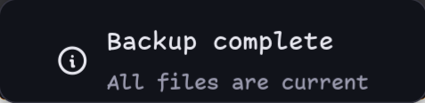
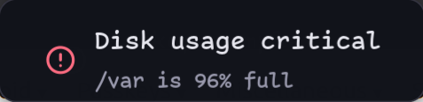

# Custom Noctalia OSD

| `severity: "info"` | `severity: "error"` |
| --- | --- |
|  |  |

Open the toast with a JSON payload:

```sh
noctalia msg panel-open pschmitt/osd:toast \
  '{"summary":"Backup complete","body":"All files are current","severity":"info","category":"backup"}'
```

`summary` is required. The optional fields are `body`, `severity` (`info`,
`warn`, or `error`), `category`, `profile`, `command`, `timeout_ms`, and
`style`. Setting `timeout_ms` to zero keeps the toast open until it is closed.
`command` runs when the toast is clicked.

## Profiles

The advanced `profile_rules` setting is a JSON array of ordered rules. Every
matching rule is applied, and later rules override earlier ones, like mako's
criteria sections. Global plugin settings are the base; an inline payload
`style` object has final precedence. The shipped defaults color the `success`,
`warning`, `error`, and `failure` categories and provide a persistent named
`critical` profile.

```json
[
  {
    "match": { "category": ["success", "backup"] },
    "style": { "icon": "circle-check", "icon_color": "#A8D38D" }
  },
  {
    "match": { "summary_contains": "Mute" },
    "style": { "summary_color": "#E27978" }
  },
  {
    "name": "critical",
    "style": {
      "icon": "alert-circle",
      "icon_color": "error",
      "summary_color": "error",
      "timeout_ms": 0
    }
  }
]
```

Exact match criteria can reference any payload field. A criterion value may be
a scalar or an array of alternatives. A key ending in `_contains`, such as
`summary_contains`, performs a literal substring match. A named rule only
matches when the payload's `profile` has the same name; it can also have a
`match` object.

Profile `style` supports:

- `show_icon`, `icon`, `icon_size`, `icon_color`
- `icon_text_gap`, `line_gap`, `padding_h`, `padding_v`, `max_text_width`
- `summary_font_size`, `summary_font_weight`, `summary_color`
- `body_font_size`, `body_color`, `text_align`, `two_line_balance`
- `content_fill`, `content_border`, `content_border_width`, `content_radius`
- `timeout_ms`

Colors accept Noctalia theme roles (for example `error` or `on_surface`) and
hex colors. The content decoration and padding apply inside Noctalia's own
fixed panel padding.

Every one of those keys is also settable per call, with no plugin reload and no
settings change, by putting it in the payload's `style` object — that is the
highest-precedence layer. `pkgs/local/osd/osd.sh` exposes the two common ones
as `--icon` / `--icon-color`, plus `--profile` and a raw `--style JSON` escape
hatch for the rest:

```sh
osd -c bluetooth -i bluetooth-connected -d "Jabra Elite 7" "Bluetooth headset connected"
osd -S '{"summary_color":"error","content_border_width":1}' "Styled per call"
```

`icon` names come from Noctalia's bundled Tabler set (`assets/fonts/tabler.json`
upstream), so `bluetooth`, `bluetooth-connected`, `bluetooth-off`,
`bluetooth-x`, `headphones` and `headset` all resolve. An unknown name renders
nothing and logs `[WRN] [glyph] missing glyph: <name>` — there is no error, so
check the journal when an icon silently fails to appear.

## Window geometry

The custom OSD uses `fit_content_width = true` on its floating panels.
Noctalia measures the actual rendered text, font, glyph, and spacing, then
resizes and centers the card. Short messages get narrow cards; longer messages
grow up to 520 logical pixels, including the host's 14px padding on each side.
This requires the `fit_content_width` host patch shipped in nixos-config.

The wrapper selects `compact` (56px high) for one line or `toast` (76px high)
for a summary and body. The legacy `-medium`, `-wide`, and `-xwide` entry IDs
remain available and now fit their content too. Direct IPC calls get the same
content sizing as the wrapper.

Font line boxes can exceed the nominal font size, so the height leaves room
for actual line metrics. `content_padding_h` and `content_padding_v` add to
the host inset. Per-call styles, glyph visibility, and profile rules participate
in the measured width. `max_text_width = 0` disables an additional text cap;
set it to a positive value to ellipsize sooner.

The outer card background, border, radius, and shadow come from Noctalia's
panel theme. Content decoration applies inside the host padding.

## Native OSDs

The `osd` wrapper also exposes Noctalia's actual built-in OSDs:

```sh
osd native volume                 # current speaker volume and mute state
osd native mic-volume             # current microphone volume and mute state
osd native volume 65              # display 65%, without changing volume
osd native brightness 50
osd native keyboard-backlight 25
```

Values are percentages (0–100). Brightness and keyboard backlight require a
value; volume and microphone volume default to their current state. These
commands require Noctalia and use its native OSD styling and timeout.
